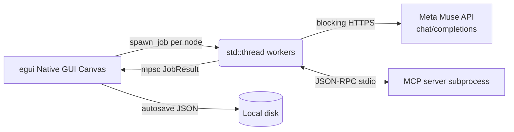

# Native Multi-Prompt AI Canvas

> **여러 AI 프롬프트를 한 캔버스에서 동시에 실행하고 비교하는 Rust 네이티브 노코드 캔버스**

[](https://opensource.org/licenses/MIT)
[](https://www.rust-lang.org/)
[]()

---

## 🎬 1. 데모 및 시각 자료 (Demo & Visuals)

* **[▶️ 데모 영상 보러가기 (YouTube/Loom 링크)](TODO: 링크 추가)**
* **[실행 파일 다운로드 (GitHub Releases)](TODO: 링크 추가)** *(빌드 없이 바로 실행 가능)*

> TODO: 데모 GIF를 녹화해 `assets/demo_preview.gif`로 저장한 뒤 아래 줄의 주석을 풀어주세요.
> <!--  -->
> *(여러 프롬프트 노드가 Meta Muse API를 호출해 결과를 나란히 보여주는 화면)*

---

## 🎯 2. 문제 정의 및 솔루션 (Problem & Solution)

* **Problem (기존의 한계):**
  프롬프트 엔지니어링과 에이전트 워크플로우 테스트 시, 단일 채팅창에서 프롬프트를 하나씩 수정하며 결과를 비교하는 과정은 극도로 비효율적입니다. 웹/일렉트론(Electron) 기반 도구들은 무거운 브라우저 엔진을 떠안고 있어 가볍게 쓰기 어렵습니다.
* **Solution (우리의 해결책):**
  코딩 없이 시각적 캔버스 위에서 **여러 프롬프트 파이프라인을 묶음 실행**하는 네이티브 데스크톱 앱을 만들었습니다. Rust + egui 네이티브 GUI에 작업은 백그라운드 스레드로 분리되어, 실행 중에도 UI가 멈추지 않습니다.

---

## ✨ 3. 핵심 기능 (Key Features)

* **🗂️ 노코드 비주얼 캔버스:** 노드 카드를 놓고 선으로 연결하면 프롬프트 체인이 완성됩니다. 무제한 CAD식 캔버스, 미니맵, 바둑판 자동 정렬 지원.
* **⚡ 3가지 묶음 실행 모드:** `병렬`(전부 동시 시작) / `순서대로` / `체인`(입력 연결 순서대로, 위상 정렬) — ON 노드 전체 실행·선택 실행·개별 실행 지원.
* **🧰 23종 실행 모드:** 일반 LLM 호출 외에 에이전트·이미지·오디오·Python 실행과 요약·번역·다듬기 등 18종 프리셋 내장.
* **🤖 에이전트 + MCP 도구:** 에이전트 모드 노드는 MCP(stdio) 서버의 도구를 오가며 답을 만듭니다. 노드별로 컨텍스트 첨부 가능.
* **✨ 블루프린트 생성:** 한 문단 설명으로 노드 최대 12개를 자동 설계·배치합니다 (연결 검증·순환 차단 포함).
* **⏰ 예약 실행 + 알람:** 시작 예약(한 번·매일·간격)과 노드별 예약을 걸고, 완료 시 텔레그램·디스코드·왓츠앱으로 알림 수신.
* **📤 결과 공유:** 메일·Facebook·Threads·Instagram 공유와 마크다운 내보내기 지원.
* **🎨 34종 테마 + 한/영 UI:** 액센트·메뉴·결과창·캔버스를 한 번에 바꾸는 테마 34종, 한국어/영어 전환.
* **💾 안전한 작업 환경:** 실행 취소/다시 실행, 0.5초 자동 저장, JSON 저장·열기, Mock 제공자로 API 키 없이 데모 가능.
* **🔒 키 보안:** API 키는 디스크에 저장하지 않음이 기본(세션 키는 메모리 한정). PC 저장 옵션을 켤 때만 보관합니다.

---

## 🏗️ 4. 시스템 아키텍처 및 기술 스택 (Architecture & Tech Stack)

**스택:** Rust · egui/eframe (네이티브 GUI) · reqwest blocking HTTP · MCP stdio (자식 프로세스 + JSON-RPC) · serde JSON 저장



* 실행 모델: 노드당 OS 스레드 1개 + `mpsc` 채널로 결과 회수. Tokio·SSE 스트리밍은 사용하지 않으며, 결과는 완성본 단위로 도착합니다(에이전트 진행 문구는 실시간 표시).
* 체인 모드는 위상 정렬로 입력이 끝난 노드부터 깨우며, 순환 연결은 원천 차단됩니다.
* LLM 연동: Meta Muse API(`muse-spark-1.3`, OpenAI 호환 `chat/completions`) + 네트워크 없이 동작하는 Mock 제공자.
* 이미지 생성: pollinations.ai, 음성 생성: Google 번역 TTS(공개 HTTP).

---

## 🚀 5. 실행 방법 (Getting Started)

1. Rust 설치: https://www.rust-lang.org/tools/install
2. 이 폴더에서 실행:

```sh
cargo run --release
```

3. 상단 바 `설정` → `AI` 탭 → 제공자 `Meta Muse API` 선택 후 키 입력:
   * 설정 창의 `세션 키`(메모리에만 보관, 종료 시 소멸), 또는
   * `MODEL_API_KEY` 환경 변수.
4. `연결 테스트` 버튼으로 키·모델·엔드포인트를 검증하세요.
5. 키 없이 둘러보려면 제공자 `Mock`을 선택하세요(데모 출력 생성).

기본값: 엔드포인트 `https://api.meta.ai/v1/chat/completions`, 모델 `muse-spark-1.3`.

---

## 🖱️ 6. 사용법 (Usage)

* `＋ 노드 추가`: 새 카드가 캔버스에 생깁니다. 타이틀바로 이동하세요.
* `✨ 블루프린트`: 원하는 구성을 한 문단으로 쓰면 노드 여러 개를 만들어 연결까지 구성합니다.
* 빈 곳 드래그: 캔버스 이동. `바둑판 정렬`·`맞춤`·미니맵으로 시점 관리.
* 각 노드: 제목 편집, `ON/OFF`, 실행 모드 선택, 프롬프트 입력, `▶ 실행`, `복제`/`삭제`, 출력 복사·크게 보기.
* 연결: 출력 동그라미 드래그, 카드의 `→ 연결` 버튼, `L`(선택 연결). 연결선 호버 시 `×`로 끊기.
* 왼쪽 메뉴: `▶ ON 전체 실행`, `▶ 선택 실행`, `출력 지우기`, `취소`, 연결 상태 칩.

---

## 📁 7. 프로젝트 구조 (Project Structure)

```text
src/
├── main.rs       앱 진입점·아이콘
├── app.rs        update 오케스트레이션·단축키·저장 훅
├── state.rs      앱 상태·Undo·노드 조작·뷰 헬퍼
├── run.rs        백그라운드 작업 실행(LLM·에이전트·MCP·배치)
├── node.rs       프롬프트 노드 데이터·연결·위상 정렬(순수 로직)
├── cards.rs      캔버스·노드 카드·포트·미니맵 렌더링
├── panels.rs     설정·정보·도구 창
├── llm.rs        LLM 추상화(Mock + Meta Muse API)
├── agent.rs      에이전트 루프(MCP 도구 호출)
├── mcp.rs        MCP stdio 클라이언트
├── blueprint.rs  한 문단 설명 → 노드 설계·생성
├── schedule.rs   시작·노드별 예약
├── alarm.rs      텔레그램·디스코드·왓츠앱 알람
├── share.rs      메일·SNS·마크다운 공유
├── media.rs      이미지·오디오 생성
├── store.rs      자동 저장·복원(JSON)
├── theme.rs      34종 디자인 테마
├── i18n.rs       한/영 UI 문자열
├── zoom.rs       캔버스 휠 줌 계산
├── fonts.rs      OS 시스템 한글 폰트 등록
├── http.rs       blocking HTTP 클라이언트 캐시
└── usability.rs  무작위 시나리오 불변식 검사(1만 건)
```

---

## 🛠️ 8. 개발 (Development)

```sh
cargo c             # 빠른 검사 (check 별칭)
cargo t             # 단위 테스트
cargo clippy --all-targets -- -D warnings
cargo fmt --check
cargo run --profile fast   # 최적화 측정용 (릴리스급 최적화, LTO 없음)
```

빌드 산출물은 OneDrive 동기화 경합을 피하려고
`.cargo/config.toml`에서 `C:/_cargo-target/prompt_canvas_gui`로 빼 두었습니다.

릴리스 빌드는 LTO + 심볼 제거 + Windows 콘솔 숨김으로 나갑니다.

---

## 📄 9. 라이선스 (License)

MIT — [LICENSE](LICENSE) 참조.
