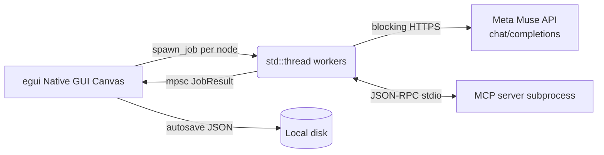

# Native Multi-Prompt AI Canvas

> **A Rust-native no-code canvas for running and comparing multiple AI prompts side by side**

[](https://opensource.org/licenses/MIT)
[](https://www.rust-lang.org/)
[]()

---

## 🎬 1. Demo & Visuals

* **[▶️ Watch the demo video (YouTube/Loom link)](TODO: add link)**
* **[Download the binary (GitHub Releases)](TODO: add link)** *(runs without building)*

> TODO: record a demo GIF, save it as `assets/demo_preview.gif`, then uncomment the line below.
> <!--  -->
> *(Multiple prompt nodes calling the Meta Muse API and showing results side by side)*

---

## 🎯 2. Problem & Solution

* **Problem:**
  When engineering prompts or testing agent workflows, editing prompts one at a time in a single chat window and comparing results is extremely inefficient. Web/Electron-based tools drag along a heavy browser engine, making them awkward for lightweight use.
* **Solution:**
  A native desktop app that **batch-runs multiple prompt pipelines** on a visual canvas — no coding required. The UI is a Rust + egui native GUI with all work offloaded to background threads, so the interface never freezes during runs.

---

## ✨ 3. Key Features

* **🗂️ No-code visual canvas:** drop node cards on the canvas and wire them up to build prompt chains. Unlimited CAD-style canvas, minimap, and grid auto-layout included.
* **⚡ 3 batch run modes:** `Parallel` (start everything at once) / `Sequential` / `Chain` (topological order along input links) — run all ON nodes, selected nodes, or single nodes.
* **🧰 23 run modes:** agent, image, audio, and Python execution plus 18 presets (summarize, translate, polish, …) alongside plain LLM calls.
* **🤖 Agent + MCP tools:** agent-mode nodes work back and forth with MCP (stdio) server tools to produce answers. Tool results can be attached per node as context.
* **✨ Blueprint generation:** describe a setup in one paragraph and get up to 12 nodes auto-designed and laid out (with link validation and cycle prevention).
* **⏰ Scheduling + alarms:** start schedules (once/daily/interval) and per-node schedules, with completion alerts via Telegram, Discord, and WhatsApp.
* **📤 Result sharing:** share via email, Facebook, Threads, and Instagram, or export as Markdown.
* **🎨 34 themes + KO/EN UI:** 34 design themes that restyle accent, menus, results, and canvas at once; Korean/English UI switch.
* **💾 Safe workspace:** undo/redo, 0.5s autosave, JSON save/open, and a Mock provider for keyless demos.
* **🔒 Key security:** API keys are never written to disk by default (session keys live in memory only). Stored on this PC only when you opt in.

---

## 🏗️ 4. Architecture & Tech Stack

**Stack:** Rust · egui/eframe (native GUI) · reqwest blocking HTTP · MCP stdio (child process + JSON-RPC) · serde JSON persistence



* Execution model: one OS thread per node, results collected over `mpsc` channels. No Tokio or SSE streaming — results arrive as completed outputs (agent progress lines do show live).
* Chain mode wakes nodes in topological order once their inputs finish; cyclic links are blocked at creation.
* LLM integration: Meta Muse API (`muse-spark-1.3`, OpenAI-compatible `chat/completions`) + a Mock provider that works offline.
* Image generation: pollinations.ai; speech generation: Google Translate TTS (public HTTP).

---

## 🚀 5. Getting Started

1. Install Rust: https://www.rust-lang.org/tools/install
2. Run from this folder:

```sh
cargo run --release
```

3. Top bar `Settings` → `AI` tab → provider `Meta Muse API`, then enter a key:
   * `Session key` in the settings window (memory only, gone on exit), or
   * the `MODEL_API_KEY` environment variable.
4. Use `Test connection` to verify the key, model, and endpoint.
5. To explore without a key, select the `Mock` provider (generates demo output).

Defaults: endpoint `https://api.meta.ai/v1/chat/completions`, model `muse-spark-1.3`.

---

## 🖱️ 6. Usage

* `＋ Add node`: a new card appears on the canvas. Drag it by the title bar.
* `✨ Blueprint`: describe the setup you want in a paragraph and nodes are created and wired up.
* Drag empty space: pan the canvas. Manage the viewport with grid layout, fit-to-view, and the minimap.
* Each node: edit title, `ON/OFF`, run-mode picker, prompt input, `▶ Run`, clone/delete, copy/enlarge output.
* Links: drag from an output port, use the card's `→ Link` button, or `L` (link selection). Hover a link for `×` to unlink.
* Left menu: `▶ Run all ON`, `▶ Run selected`, clear outputs, cancel, link-status chips.

---

## 📁 7. Project Structure

```text
src/
├── main.rs       app entry point, icon
├── app.rs        update orchestration, shortcuts, save hooks
├── state.rs      app state, undo, node ops, view helpers
├── run.rs        background jobs (LLM, agent, MCP, batch)
├── node.rs       prompt node data, links, topo sort (pure logic)
├── cards.rs      canvas, node cards, ports, minimap rendering
├── panels.rs     settings, info, tool windows
├── llm.rs        LLM abstraction (Mock + Meta Muse API)
├── agent.rs      agent loop (MCP tool calls)
├── mcp.rs        MCP stdio client
├── blueprint.rs  paragraph description -> node design & creation
├── schedule.rs   start & per-node schedules
├── alarm.rs      Telegram, Discord, WhatsApp alarms
├── share.rs      email, SNS, Markdown sharing
├── media.rs      image & audio generation
├── store.rs      autosave & restore (JSON)
├── theme.rs      34 design themes
├── i18n.rs       KO/EN UI strings
├── zoom.rs       canvas wheel-zoom math
├── fonts.rs      OS system Korean font registration
├── http.rs       blocking HTTP client cache
└── usability.rs  randomized-scenario invariant checks (10k cases)
```

---

## 🛠️ 8. Development

```sh
cargo c             # fast check (alias)
cargo t             # unit tests
cargo clippy --all-targets -- -D warnings
cargo fmt --check
cargo run --profile fast   # optimization measurement (release opts, no LTO)
```

To avoid OneDrive sync contention, build output is redirected to
`C:/_cargo-target/prompt_canvas_gui` via `.cargo/config.toml`.

Release builds ship with LTO + symbol stripping + hidden Windows console.

---

## 📄 9. License

MIT — see [LICENSE](LICENSE).
