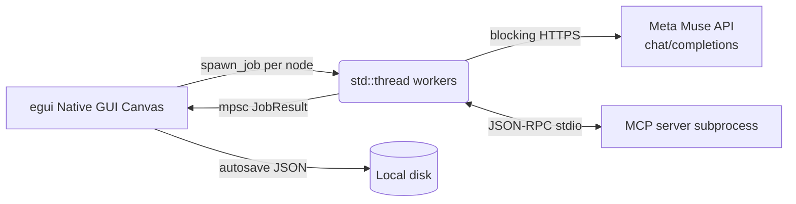

## 🚀 Symphony Canvas_Native Multi-Prompt AI Canvas

    A lightweight Rust-native no-code canvas for running and comparing AI prompts simultaneously without lag.

## 🎥 1. Demo & Visuals

  ▶️ Watch the Demo Video 

  https://youtu.be/7bodMlT_hnM?si=l0TOOuWOYKIfD5ZV


(▲ 12 prompt nodes simultaneously invoking Meta muse spark 1.3 models and rendering real-time streaming results)
## 💡 2. Problem & Solution


    Problem:
    
    Traditional single-window chat interfaces force developers and creators into repetitive manual cycles—copying outputs between prompts, losing track of intermediate experiments, and struggling to
    orchestrate multi-step LLM pipelines. Existing visual workflow tools are typically bloated Electron/web wrappers that lag under load and lack deep native OS integration.

    Solution:

    - **Zero-Lag Rust GUI:** Built entirely with Rust (`egui`/`eframe`) using multi-threaded OS background workers over `mpsc` channels—delivering a lightweight, responsive desktop UI that never freezes during heavy concurrent inference.
    - **Topological Prompt Chaining:** Connect nodes intuitively with directed links. Downstream nodes automatically ingest upstream outputs with cycle prevention and topological ordering.
    - **3 Batch Run Modes:** Execute workflows via `Parallel` (simultaneous runs), `Sequential`, or `Chain` execution.
    - **AI Blueprint Generator:** Transforms a single natural language description into an end-to-end multi-node canvas pipeline (up to 12 auto-wired and laid-out nodes).
    - **23 Run Modes & Agentic MCP:** Combines direct LLM calls with custom Python execution, media nodes, and MCP (Model Context Protocol stdio) autonomous agents capable of dynamic tool calling.
    - **Real-World Notification Loop:** Native scheduling and automated completion alerts dispatched directly to Telegram, Discord, and WhatsApp.
    - **Privacy & Security First:** Session API keys are stored in volatile memory only by default, ensuring enterprise-grade credential security.

## ✨ 3. Key Features


    ⚡ Parallel Prompt Orchestration: Simultaneously invoke and compare 10 different prompt/parameter combinations asynchronously with a single click, featuring real-time streaming.

    🎨 No-Code Visual Canvas: An intuitive node-based UI designed to build complex prompt chaining and A/B testing effortlessly.

    🦀 Ultra-Lightweight Native Performance: Implemented as a Rust-native GUI, minimizing memory footprint during idle and multi-run states while ensuring a zero-latency UI.

    🦙 Seamless Meta AI Integration: Optimized prompt templates for Meta Llama series endpoints along with a real-time token/speed metrics dashboard.

    🗂️ 3 Batch Execution Modes: Supports Parallel, Sequential, and Chain (topological order along input links) execution modes.

    🤖 Agent & MCP Tool Integration: Equipped with agent nodes that interact with stdio-based MCP servers and automated blueprint generation.

---

## 🏗️ 4. Architecture & Tech Stack

**Stack:** Rust · egui/eframe (native GUI) · reqwest blocking HTTP · MCP stdio (child process + JSON-RPC) · serde JSON persistence



* Execution model: one OS thread per node, results collected over `mpsc` channels. No Tokio or SSE streaming — results arrive as completed outputs (agent progress lines do show live).
* Chain mode wakes nodes in topological order once their inputs finish; cyclic links are blocked at creation.
* LLM integration: Meta Muse API muse-spark-1.3 + a Mock provider that works offline.
* Image generation: pollinations.ai; speech generation: Google Translate TTS (public HTTP).

---

## 🚀 5. Getting Started

1. Install Rust: https://www.rust-lang.org/tools/install
2. Run from this folder:

```sh
cargo run --release
```

3. Top bar `Settings` → `AI` tab → provider `Meta Muse API`, then enter a key:
   * `Session key` in the settings window (memory only, gone on exit), or
   * the `MODEL_API_KEY` environment variable.
4. Use `Test connection` to verify the key, model, and endpoint.
5. To explore without a key, select the `Mock` provider (generates demo output).

Defaults: endpoint `https://api.meta.ai/v1/chat/completions`, model `muse-spark-1.3`.

---

## 🖱️ 6. Usage

* `＋ Add node`: a new card appears on the canvas. Drag it by the title bar.
* `✨ Blueprint`: describe the setup you want in a paragraph and nodes are created and wired up.
* Drag empty space: pan the canvas. Manage the viewport with grid layout, fit-to-view, and the minimap.
* Each node: edit title, `ON/OFF`, run-mode picker, prompt input, `▶ Run`, clone/delete, copy/enlarge output.
* Links: drag from an output port, use the card's `→ Link` button, or `L` (link selection). Hover a link for `×` to unlink.
* Left menu: `▶ Run all ON`, `▶ Run selected`, clear outputs, cancel, link-status chips.

---

## 📁 7. Project Structure

```text
src/
├── main.rs       app entry point, icon
├── app.rs        update orchestration, shortcuts, save hooks
├── state.rs      app state, undo, node ops, view helpers
├── run.rs        background jobs (LLM, agent, MCP, batch)
├── node.rs       prompt node data, links, topo sort (pure logic)
├── cards.rs      canvas, node cards, ports, minimap rendering
├── panels.rs     settings, info, tool windows
├── llm.rs        LLM abstraction (Mock + Meta Muse API)
├── agent.rs      agent loop (MCP tool calls)
├── mcp.rs        MCP stdio client
├── blueprint.rs  paragraph description -> node design & creation
├── schedule.rs   start & per-node schedules
├── alarm.rs      Telegram, Discord, WhatsApp alarms
├── share.rs      email, SNS, Markdown sharing
├── media.rs      image & audio generation
├── store.rs      autosave & restore (JSON)
├── theme.rs      34 design themes
├── i18n.rs       KO/EN UI strings
├── zoom.rs       canvas wheel-zoom math
├── fonts.rs      OS system Korean font registration
├── http.rs       blocking HTTP client cache
└── usability.rs  randomized-scenario invariant checks (10k cases)
```

---

## 🛠️ 8. Development

```sh
cargo c             # fast check (alias)
cargo t             # unit tests
cargo clippy --all-targets -- -D warnings
cargo fmt --check
cargo run --profile fast   # optimization measurement (release opts, no LTO)
```

To avoid OneDrive sync contention, build output is redirected to
`C:/_cargo-target/prompt_canvas_gui` via `.cargo/config.toml`.

Release builds ship with LTO + symbol stripping + hidden Windows console.

---

## 📄 9. License

MIT — see [LICENSE](LICENSE).
